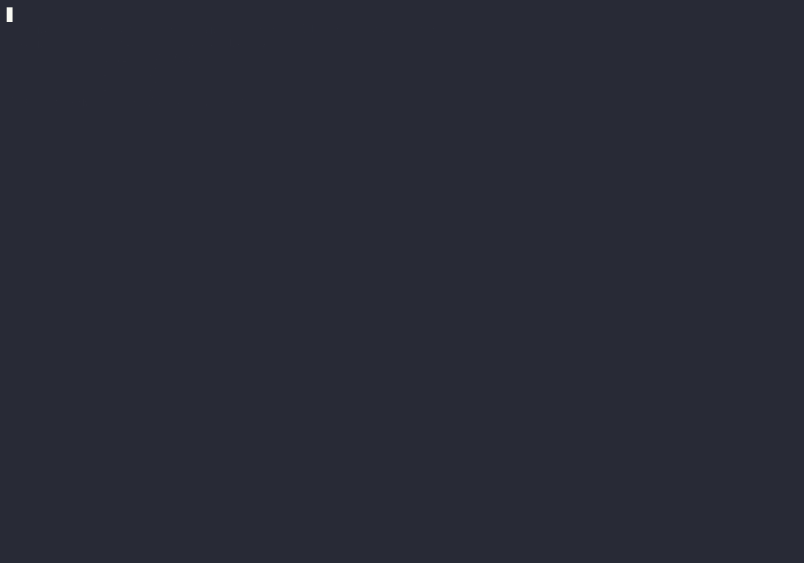

# jvm-fit

[](https://github.com/andronaft/jvm-fit/actions/workflows/ci.yml)
[](LICENSE)

**jvm-fit reads your pod spec and JVM flags together and tells you, before
deploy, if the JVM will fit in the container.**

## The problem

Java in Kubernetes often breaks even when "everything is configured":

| What you see | The real cause |
|---|---|
| Pod is **OOMKilled**, heap is only 60% full | Heap takes almost the whole limit; **non-heap** (metaspace, thread stacks, code cache, direct buffers) does not fit |
| App is slow, CPU usage is low | **CPU limit** → throttling; with a limit below 2 cores the JVM picks **SerialGC** |
| Memory is "used", but the heap is small | No heap flags → heap is **25%** of the limit, the rest sits idle |
| Pod on a big node takes an 8Gi heap | **No memory limit** → the JVM takes a percentage of the **whole node** |
| Pod restarts during startup | Liveness probe kills a slow-starting JVM (no **startup probe**) |

## Demo

A Spring Boot pod on a kind cluster is OOMKilled with the heap at about 50%.
jvm-fit explains why from the manifest, and its fix keeps the pod up under the
same load ([run it yourself](demo/README.md)):



## Install

```bash
go install github.com/andronaft/jvm-fit/cmd/jvm-fit@latest
```

## Use

```bash
jvm-fit scan ./k8s/                            # files and directories
jvm-fit scan ./charts/payments -f values.yaml  # Helm chart
jvm-fit scan ./k8s/overlays/prod               # Kustomize overlay
jvm-fit explain JVM007                         # why it matters, how to fix it
```

```
$ jvm-fit scan testdata/payments-api.yaml

payments-api (Deployment, container: app)  image: eclipse-temurin:17-jre
  testdata/payments-api.yaml:15  limits: memory=1Gi cpu=500m   flags: -Xmx900m (JAVA_TOOL_OPTIONS)

  Memory budget
    container limit        1024Mi
    heap max (-Xmx)         900Mi
    non-heap estimate      ~350Mi
    ─────────────────────────────
    needed                ~1250Mi   ❌ over limit by ~226Mi

  HIGH     JVM003  Heap + non-heap needs ~1250Mi, limit is 1024Mi (over by ~226Mi) → OOMKilled under load
                   fix: -XX:MaxRAMPercentage=70 and memory limit 1.25Gi, or keep the limit and use -XX:MaxRAMPercentage=65
  ...
```

Output as text, JSON or SARIF, or use the
[GitHub Action](docs/github-action.md) to annotate pull requests. All flags,
exit codes and how the model works are in the [usage guide](docs/usage.md).

## Rules

| ID | Checks | Severity |
|---|---|---|
| JVM001 | No memory limit, heap is a percentage (explicit or default) | high |
| JVM002 | `-Xmx` ≥ memory limit | critical |
| JVM003 | heap + non-heap estimate > memory limit | high |
| JVM004 | `MaxRAMPercentage` > 80 | medium |
| JVM005 | No `-Xmx` and no `MaxRAMPercentage` → heap is 25% of the limit (HotSpot) | low |
| JVM006 | Fixed `-Xmx` in absolute units | info |
| JVM007 | No GC set and the JVM will pick SerialGC (CPU < 2 or memory < 1792Mi) | medium |
| JVM008 | CPU limit < 1 core | medium |
| JVM009 | `-XX:-UseContainerSupport` | high |
| JVM010 | `ActiveProcessorCount` > CPU limit | medium |
| JVM011 | Memory request < limit | low |
| JVM012 | No startup probe and liveness `initialDelaySeconds` < 30 | medium |

## Evidence

The heap, CPU and GC model is checked against real JVMs. On every CI push, a
[test](internal/model/docker_evidence_test.go) starts JDK 11, 17 and 21 in
Docker and fails if the model predicts something else. The
[measurements](docs/evidence/results.md) also cover OpenJ9 21. Three results
that are easy to get wrong:

- 2 CPUs with a 1Gi limit still gives **SerialGC** (G1 also needs ~1792Mi).
- A 256Mi limit gives a 126M heap, not 25% (64M).
- With `-XX:-UseContainerSupport` a 1Gi container gets a heap sized from the
  host memory.

The 350Mi non-heap default is an **estimate**, not a measurement: set your own
with `--nonheap-estimate`. See [what is not measured yet](docs/evidence/README.md#todo).

## Compared with KRR and Goldilocks

These tools size containers from real usage. They answer a different question,
so you can use them together: they tell you how much memory the app needs,
jvm-fit checks that the JVM flags fit that limit.

| | jvm-fit | [KRR](https://github.com/robusta-dev/krr) | [Goldilocks](https://github.com/FairwindsOps/goldilocks) |
|---|---|---|---|
| Works from | Manifests, Helm, Kustomize | Prometheus history | VPA recommendations |
| Needs a running workload | No | Yes | Yes |
| Uses real usage | No (estimate) | Yes | Yes |
| Reads JVM flags | Yes | Not in its README | Not in its README |
| Suggests | JVM flags and memory limit | CPU and memory requests and limits | Resource requests |

Based on each project's README, November 2026.

## Limits

jvm-fit is a static check. It does not see your app's real memory use, and it
does not read live clusters yet. Both are planned for v0.2, using Prometheus
metrics.

## License

[Apache-2.0](LICENSE)
