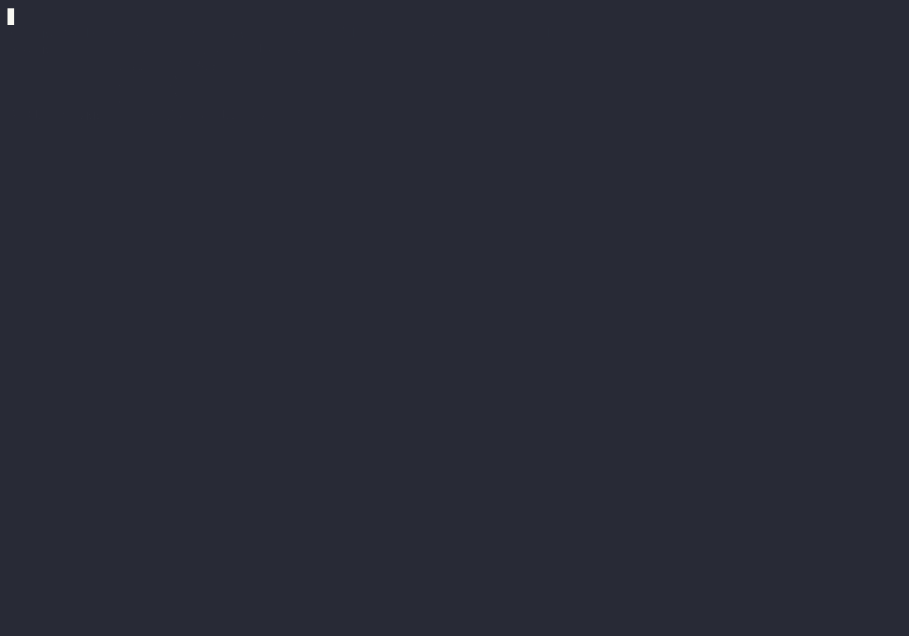

# Demo: OOMKilled with a half-empty heap

A real run on a [kind](https://kind.sigs.k8s.io/) cluster:

1. A Spring Boot service runs with `-Xmx450m` in a 512Mi container.
2. The pod is OOMKilled (exit code 137). The last line it logged shows the heap
   only about half full.
3. `jvm-fit scan` explains why from the manifest alone, and suggests a fix.
4. With the fix, the same app under the same load stays up: 0 restarts.



```bash
demo/setup.sh    # cluster, app image, jvm-fit binary
demo/run.sh      # takes about 3 minutes
demo/cleanup.sh  # delete the cluster
demo/record.sh   # record docs/demo.gif (needs asciinema and agg)
```

Needs Docker, kind, kubectl and Go. The demo uses its own kubeconfig
(`demo/.kubeconfig`), so your current kubectl context does not change.

`run.sh` reads every result from the cluster and stops with an error if the
pod is not OOMKilled, or if it restarts after the fix.

## What it does and does not show

- The app is made for this demo. [`OrdersApplication`](app/src/main/java/demo/OrdersApplication.java)
  keeps a fixed 260Mi in the heap and 140Mi in direct buffers (what Netty and
  NIO clients do), so both configurations get the same load.
- The crash and the stable run are real. The exact numbers change a little
  between runs: the recorded run shows the heap at 51% at the last log line
  and a peak of 670Mi of the 832Mi limit after the fix.
- The non-heap number in the report (~350Mi) is the default estimate, not a
  measurement of this app.
- "Stable" means 0 restarts for one minute after the full load, not a
  long-running test. In the GIF, waits longer than 4 seconds are cut to 4
  seconds.

## Notes

- `KIND_IMAGE` selects the Kubernetes version (default `kindest/node:v1.33.1`).
  The newest kind image failed in `kubeadm init` on a Docker host with cgroup
  v1; 1.33 works there.
- Give Docker at least 2 GiB of memory. This was recorded on a 2 GiB VM.
